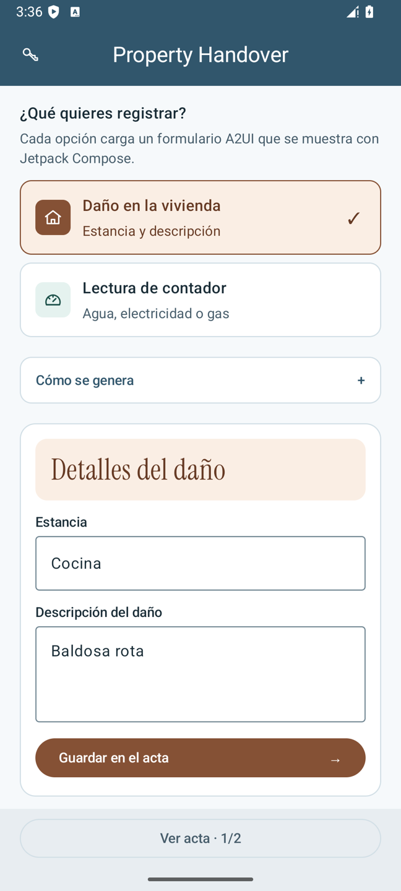
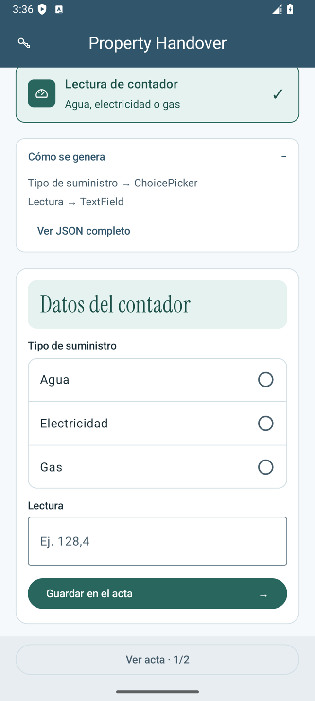
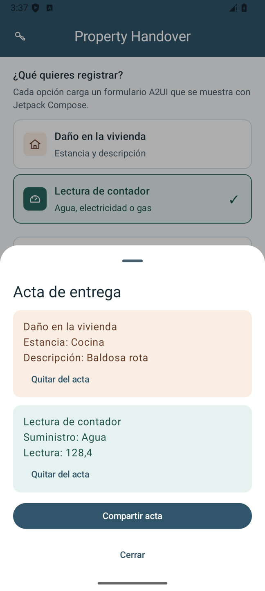

# Property Handover

Property Handover is an offline Android demo of **A2UI 1.0 and Jetpack Compose**. During a key handover, record property damage and a utility meter reading, review both in one report, and share it through Android's Sharesheet.

[Download the signed APK for v0.1.0](https://github.com/DemiterHugo/PropertyHandover/releases/download/v0.1.0/PropertyHandover-v0.1.0.apk) · [Release notes](https://github.com/DemiterHugo/PropertyHandover/releases/tag/v0.1.0)

The app runs on Android 8.0 (API 26) or later and has a Spanish interface. It keeps one damage entry and one reading in memory for the current session.

## Screenshots

Captured from the published APK on an Android 15 emulator using fictional data.

| Damage form | Meter form and A2UI inspector | Combined handover report |
| :---: | :---: | :---: |
|  |  |  |

## Try the demo

1. Choose **Daño en la vivienda** and open **Cómo se genera**. Close the panel, enter **Cocina** and **Baldosa rota**, then tap **Guardar en el acta**.
2. Open **Cómo se genera** again and switch to **Lectura de contador**. The panel stays open and its field list changes with the form. Select **Agua**, enter the fictional reading **128,4**, and tap **Guardar en el acta**.
3. Tap **Ver acta · 2/2** to review both entries and **Compartir acta** to open the Android Sharesheet.

## How A2UI defines the forms

The two forms share one [Compose renderer](app/src/main/java/io/github/demiterhugo/propertyhandover/ui/A2uiForm.kt). [damage.json](data/src/main/resources/a2ui/damage.json) declares a short text field and a multiline description. [meter.json](data/src/main/resources/a2ui/meter.json) declares a `ChoicePicker` for the utility and a numeric `TextField`. For example, `displayStyle: "checkbox"` with `variant: "mutuallyExclusive"` renders a single-choice Material 3 radio list in the meter form.

Each bundled [A2UI 1.0](https://github.com/a2ui-project/a2ui/blob/main/specification/v1_0/docs/a2ui_protocol.md) message uses `createSurface` with inline `components` and `dataModel` from a subset of the [Basic Catalog](https://github.com/a2ui-project/a2ui/blob/main/catalogs/basic/v1/catalog.json). In the app, **Cómo se genera** shows how each field maps to a component and **Ver JSON completo** opens the actual bundled message. The renderer loads the files locally, so the demo needs neither a server nor an AI service.

Edit a label or reorder the IDs in the `details` column, then rebuild to see the change. The required field paths are the contract with the corresponding domain rules.

| A2UI component | Supported here |
| --- | --- |
| `Column` | Static list of child IDs in display order |
| `Card` | A single child component |
| `Text` | Literal text, with a single-line `## ` prefix rendered as a heading |
| `TextField` | Literal label, optional literal placeholder, `shortText`, `longText`, or `number`, and a binding to a string |
| `ChoicePicker` | `mutuallyExclusive` options bound to a string array. `chips` renders filter chips and `checkbox` renders a single-choice radio list. |
| `Button` | Primary button with a `Text` child. The local `saveToReport` event saves a valid entry. |

Bindings use `@path` with a single top-level key. The parser rejects malformed messages and unsupported components before rendering, and the user can still switch to the other form. Business validation runs when an entry is saved. The acta keeps the last validated value while you edit a draft. Saving again replaces that entry.

## Architecture

| Module | Responsibility | Project dependencies |
| --- | --- | --- |
| `:app` | Compose and Material 3 UI, A2UI renderer, MVVM with StateFlow, Hilt wiring, and Android sharing | `:data`, `:domain` |
| `:data` | Loads and parses bundled A2UI messages on the JVM | `:domain` |
| `:domain` | Pure Kotlin validation and report formatting | None |

## Build and verify

Open the project in Android Studio with **JDK 25**, **Android SDK Platform 37.0**, and **Build Tools 36.0.0**, then run the `app` configuration. From the repository root, use the Gradle Wrapper to build and run the same checks as GitHub Actions.

```sh
./gradlew :app:assembleDebug :domain:test :data:test :app:lintDebug
```

The debug APK is `app/build/outputs/apk/debug/app-debug.apk`. The unit tests cover the A2UI parser and domain rules. Run `./gradlew :app:connectedDebugAndroidTest` with one emulator or device to test validation, switching forms, inspecting the JSON, and sharing the combined report.

## Release build and license

Run `./gradlew :app:assembleRelease` to generate `app/build/outputs/apk/release/app-release-unsigned.apk`. Use the signed APK linked above to install the published version.

See the [changelog](CHANGELOG.md) and the [Apache 2.0 license](LICENSE). The bundled Instrument Serif font is distributed under the [SIL Open Font License](app/src/main/assets/licenses/instrument-serif.txt).
